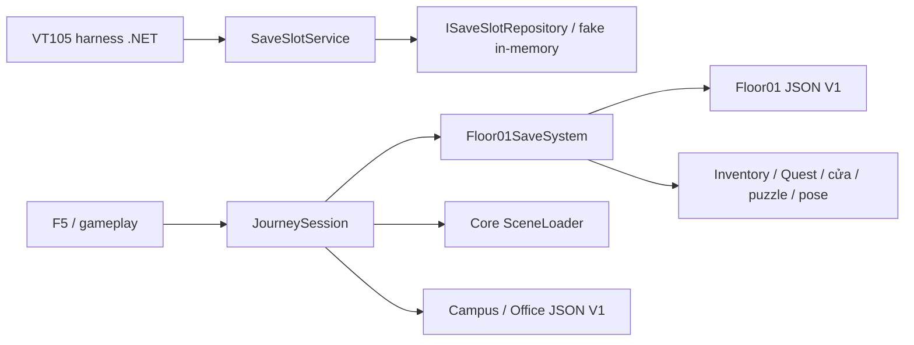

# Các hệ thống save hiện có

Đây là ba phạm vi khác nhau, không phải ba tầng của cùng backend.

| Thành phần | Vị trí / assembly | Dữ liệu và trách nhiệm | Quan hệ thực tế |
| --- | --- | --- | --- |
| SaveSlotService / SaveSlotPolicy / SaveSlot | `assignments/VT105/SaveSystem`, .NET 8 harness; namespace `CampusEscape.SaveSystem` | UserId, SaveName, GameDataJson opaque; quyền sở hữu, soft-delete, restore và retention mặc định 24h | Chỉ `tools/VT105` và legacy tests gọi. `ISaveSlotRepository` là abstraction, harness dùng in-memory; chưa có adapter file/database/account/UI game. |
| Floor01SaveSystem / SaveJson | `HUS_Escape/Assets/_Project/Scripts/Utilities`, `Assembly-CSharp`, namespace `HUSEscape.Persistence` | File `floor01-v1.json`: inventory, 17 quest facts/signature, cửa, tủ mã, sequence/LAB, pose player. Kiểm tra JSON/version/type/domain, restore im lặng, rollback/fallback spawn | Journey gọi capture/restore/New Game và kiểm tra RecoveryRequired. Floor01SaveSystem thao tác scene Floor01, không sở hữu toàn bộ hành trình. |
| JourneySession / JourneySceneEntry | cùng `Utilities`, `Assembly-CSharp`, namespace `HUSEscape.World` | Một session RAM qua scene; snapshot Floor, Campus/Office facts, proposal chưa commit, load/recovery/outcome. File `campus-v1.json`, `trainingoffice-v1.json` | Dùng Floor01SaveSystem cho slot Floor; tự validate/ghi hai slot khu vực; SceneLoader của Core là đường chuyển scene. Không dùng SaveSlotService. |

Không có đường nối Slot → Journey/Floor trong mã hiện tại. Soft-delete/account/retention của bài tập **không phải** tính năng đã hoàn thành của save game.

## Luồng game V1

- File nằm dưới `Application.persistentDataPath`; platform/CompanyName/ProductName quyết định đường dẫn thật. Không hard-code đường dẫn home vào scene.
- F5 lưu thủ công; ghi đè cần xác nhận. Ghi qua `.pending`, replace/move cùng thư mục, giữ `.previous` khi ghi đè. `.pending` không được coi là slot hợp lệ.
- Continue đọc và validate trước khi áp dụng: JSON hỏng, thiếu trường, sai kiểu/version, inventory/facts không hợp lệ bị từ chối. Campus V1 cũ có thể thiếu `officeFacts` và được đọc thành mảng rỗng; Office vẫn cần dữ liệu bắt buộc.
- Proposal tách khỏi dữ liệu đã xác nhận. Chỉ commit khi scene/restore thành công. Source còn thì khôi phục input/modal/pose theo transaction; source đã mất thì giữ checkpoint RAM và dùng recovery, không giả vờ rollback scene.
- Restore im lặng không gọi pickup/reward; tránh nhân đôi item và thông báo. Vị trí kiểm tra capsule/nền; có spawn dự phòng hoặc từ chối nếu không có chỗ an toàn.
- New Game đặt lại phiên, không xóa file. Retry sau bị bắt giữ live progress, tải lại khu vực về spawn; thắng/về menu không autosave. Về menu thành công hủy Session, Start tạo phiên mới.

Save V1 chỉ có phạm vi Floor/Campus/Office; AI patrol state, outcome thắng/bị bắt và checkpoint recovery trong RAM không được persist. Chưa có cloud sync, account, nhiều user slot UI, soft-delete hay format nâng cấp V2.

## Vì sao di chuyển assignment

Trước khi sửa đã tìm tất cả reference `SaveSlotService`, `SaveSlotPolicy`, `CampusEscape.SaveSystem` ngoài cache: caller thực thi nằm trong harness; Unity root không import thư mục `Assets/` ở repository root. Source chỉ phụ thuộc `System.*`; không scene/prefab/.meta hoặc asmdef nào của game tham chiếu nó. Vì vậy source được chuyển **nguyên byte** sang assignment, không tích hợp giả vào game.

Cập nhật Compile Include của Harness.csproj và đường dẫn mutation experiment; legacy NUnit được giữ trong `LegacyTests`, có lỗi cú pháp lịch sử và không chạy. Harness trực tiếp compile source thật, kiểm tra auth/retention/config/restore persistence; không mô phỏng lại logic trong game. Không thay đổi nghiệp vụ SoftDelete hay cam kết ACID/concurrency của repository abstraction.

Tham khảo: [assignment](../../assignments/VT105/README.md), [save transactions](../TechnicalDesign/JOURNEY_SAVE_TRANSACTIONS.md), [MVP loop](../TechnicalDesign/MVP_ESCAPE_LOOP.md), [kết quả chuẩn hóa](../Development/REPOSITORY_STANDARDIZATION_RESULTS.md).
