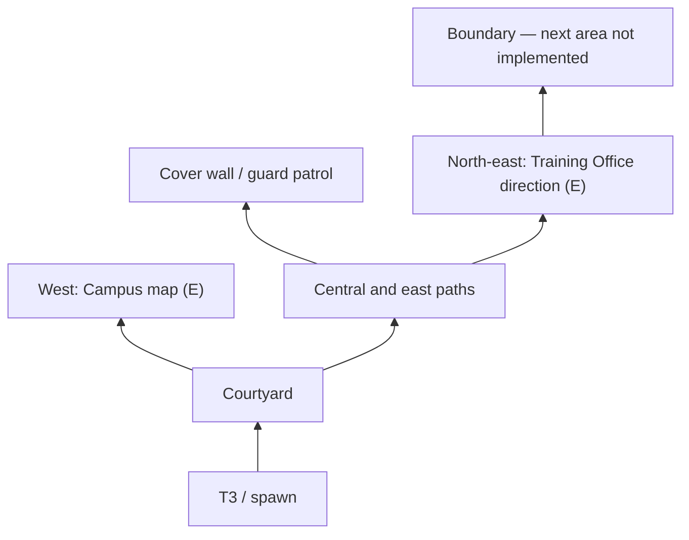

# Stage 13 — Campus foundation and scene transition

Stage 13.1 replaces the end-wall portal with a walkable ground-level exit
vestibule. See [T3_EXIT_VESTIBULE.md](T3_EXIT_VESTIBULE.md) for its inspection,
layout, save compatibility and current verification. Historical Stage 13 counts
and evidence below describe that earlier delivery.

The existing A101/A102/LAB gameplay and its 17 objectives remain intact. Campus
adds three small exploration facts and one prototype guard. There is no Training
Office scene, Main Gate, combat, arrest or Game Over implementation.

## Scene flow and ownership

Open `Assets/_Project/Scenes/Floor01_Prototype.unity` to play the current route.
After confirming LAB completion, return through the open LAB door to the central
corridor and walk to its north end, approximately `(0, 1, 60)`. Walk through the
held-open entrance at Z=62.1 into the ground-level vestibule, then to the visible
T3 door at Z=72 (stand near Z=70.5). Press E to leave T3. Proximity alone never
loads a scene. Incomplete floor objectives, unsettled interaction/IK, airborne
Player or an invalid destination reject the request with visible feedback.

`BuildingExit -> JourneySession -> existing GameBootstrap/SceneLoader`
loads `Assets/_Project/Scenes/Campus_Prototype.unity` using the unchanged
production Single-mode backend, ending in GameState.Playing. The loader's
existing reservation tokens protect against overlapping/stale requests. Only
Core and the instance-owned JourneySession persist. There is no static Instance,
global service locator or replacement Core implementation.

Each scene has one JourneySceneEntry with explicit Player, camera, Inventory,
Quest/UI and spawn references. Floor also binds its original Save V1 service.
Campus contains a saved ActorRig cloned in the Editor from the accepted Player,
camera and Quest/UI components, with all cross-root references remapped. The
floor's child puzzle props are deliberately excluded. ActorRig starts inactive;
composition activates it and applies state before normal gameplay updates.

Single-mode unload destroys the source actors. Destination actors reuse the same
scripts, model, Avatar, controller, clips, settings and existing Inventory type.
Pure checkpoint data transfers between them; no old scene object references are
used to reconstruct progress. There is one active Player/camera/Inventory/
QuestManager after each load. Scene subscriptions are instance events; persistent
session subscriptions are removed on destruction and scene bindings detach when
their scene is destroyed. Core is composed only if direct Floor play has no
initialized owner; an existing initialized bootstrap is reused.

Native loading is asynchronous, automatically activates the destination and
cannot be cancelled after acceptance. Requests are not queued. Rejection releases
the source input gate; loader failure recovers its owned GameManager state and
shows the error. Scene authoring and audit verify the destination composition.

Build scene order is now:

1. Bootstrap/Bootstrap.unity
2. MainMenu/MainMenu.unity
3. Assets/Scenes/SampleScene.unity
4. Floor01_Prototype.unity
5. Campus_Prototype.unity

The first three entries and startup configuration remain unchanged; Main Menu
Start still targets SampleScene. Stage 13 is played by opening Floor01_Prototype.
Only EditorBuildSettings.asset changes in ProjectSettings. Two existing catalog
test expectations now assert this exact five-scene list; Core/MainMenu runtime
code is unchanged. No Packages or render-pipeline/version settings change.

## Saved Campus layout

All geometry, actors, colliders, waypoints, lighting and signs are saved in the
real Campus scene and remain editable. No map is generated only in Play Mode.
Existing Floor01 materials and Unity primitives are reused; no new material,
texture, prefab, model or package is required.

North is increasing Z. The fenced playable area is about 57 x 64 metres.

| Feature | Approximate X/Z |
| --- | --- |
| T3 facade and entrance | 0 / 0; building extends south |
| Campus Player spawn | 0 / 8 |
| Courtyard discovery | 0 / 20 |
| Map/sign discovery | -12 / 30; signpost offset to edge of path |
| Opaque stealth cover wall | 6 / 30 |
| Guard patrol rectangle | X 12–22, Z 22–36 |
| Training Office direction discovery | 16 / 48 |
| North boundary | Z 62 |

Benches, tree planters and six lamps sit beside connected walkways. A single
directional light, dusk ambient light and reused materials provide a readable
stealth prototype. Planter/trunk, bench, building, boundary and cover colliders
are solid; foliage, path decals and signs do not add unnecessary mesh colliders.
The signpost discovered during testing was moved out of the walkway centre.

The existing QuestManager retains its original Definitions, CurrentIndex and
IsComplete meaning for the 17 floor objectives. CampusActive adds three facts to
the same observed-fact set and a combined journal view:

- `campus:courtyard`: enter the courtyard.
- `campus:map`: press E at the west map.
- `campus:direction`: press E at the north-east direction sign.

J shows the completed floor entries plus Campus progress. Completion of these
three objectives leaves the game in Playing with further exploration guidance.
GameplayInputGate, Tab Inventory, E/F and movement retain their existing roles.
UI restoration suppresses duplicate startup and completion notifications.

## Patrol prototype

PatrolGuard is the first AI component in the previously empty AI folder. It uses
the built-in CharacterController, four real waypoints and a forward sphere sweep
to stop against an obstruction. It does not add a navigation package or duplicate
the Player movement system. Its authored patrol route is physically tested.

- Patrol: 1.5 m/s around the east rectangle; body indicator green.
- Suspicious: visible evidence has begun or Alert has lost sight; yellow.
- Alert: continuous visibility for 1.3 seconds; red. No combat/capture follows.
- Lost visibility for 3 seconds returns to Patrol.

Sight defaults to 14 m and a 90-degree cone, sampled at 10 Hz. Physics rays ignore
triggers, this guard and the target's descendants; any other collider before the
target occludes sight. The real cover wall blocks detection. Range, cone, speed,
delay and mask are Inspector settings. A new obstacle on the patrol route stops
the guard; dynamic route finding and chasing are intentionally deferred.

## Save compatibility and slot policy

The original `floor01-v1.json` format, version, filename and meaning are unchanged.
Floor01SaveSystem's existing validator is shared as a pure-data validation hook;
its capture and silent restore hooks are reused. It still restores the same
Inventory, doors, rewards, puzzles, LAB and safe pose without animation/rewards.

Campus uses one separate manual slot, `campus-v1.json`, under
Application.persistentDataPath. It has its own format version 1, exact Campus
scene path, an embedded unchanged Floor01SaveData snapshot, three Campus facts,
Player position and yaw. The embedded snapshot preserves all 17 floor objectives,
ordinary keys and puzzle states without depending on unloaded floor objects.
No migration or overwrite of the old V1 file is necessary.

F5 displays the current slot explicitly:

- Save in Floor writes the original V1 slot; Save in Campus writes the Campus slot.
- Existing slots require overwrite confirmation. Atomic `.pending` replacement
  retains the previous file as `.previous` on confirmed overwrite.
- Continue current area reads its slot. If the other slot exists, a separate
  clearly named Continue action permits loading it, including Campus from a
  fresh Floor session. Both are read-only with respect to disk saves.
- Confirmed New Game returns to fresh Floor 01, keeping both disk slots intact.
- Travel never autosaves or creates incremental save files.

Both formats reject bad JSON, unsupported versions, inconsistent facts/items or
invalid positions before scene changes. Campus validates against the original
17-definition signature and original three key IDs. Pose restoration checks for
overlap and support, using the scene spawn if the saved position is blocked.
Only grounded, safe Campus positions can be saved. Keys are restored into the
existing Inventory once, without spawning floor pickups in Campus.

Guard position, suspicion and alert memory are transient; Continue starts the
guard on its authored patrol. There is no autosave, cloud storage or automatic
recovery from `.previous`. Starting Campus directly without a snapshot gives
guidance to Continue Campus or New Game Floor, rather than silently granting
completed floor progress. Return to Floor is through F5 Continue/New Game in V1;
a physical return portal is not part of this stage.

## Files changed in Stage 13

Existing files modified relative to the accepted Stage 12 working tree:

- `HUS_Escape/Assets/_Project/Scenes/Floor01_Prototype.unity`
- `HUS_Escape/Assets/_Project/Scripts/Utilities/Floor01SaveSystem.cs`
- `HUS_Escape/Assets/_Project/Scripts/Puzzle/QuestManager.cs`
- `HUS_Escape/Assets/_Project/Scripts/Puzzle/QuestPuzzleUI.cs`
- `HUS_Escape/Assets/_Project/Scripts/Puzzle/LabRestoreSystem.cs` (exit guidance text only)
- `HUS_Escape/ProjectSettings/EditorBuildSettings.asset`
- `HUS_Escape/Assets/_Project/Scripts/Core/Tests/Editor/BootstrapSceneEntryTests.cs` (catalog expectation only)
- `HUS_Escape/Assets/_Project/Scripts/UI/Tests/Editor/MainMenuSceneTests.cs` (catalog expectation only)

New Unity files:

- `Assets/_Project/Scenes/Campus_Prototype.unity` and `.meta`
- `Assets/_Project/Scripts/Utilities/JourneySession.cs` and `.meta`
- `Assets/_Project/Scripts/Utilities/JourneySceneEntry.cs` and `.meta`
- `Assets/_Project/Scripts/Interaction/BuildingExit.cs` and `.meta`
- `Assets/_Project/Scripts/Puzzle/CampusDiscovery.cs` and `.meta`
- `Assets/_Project/Scripts/AI/PatrolGuard.cs` and `.meta`

New repository-only tools under `tools/Campus/`: CampusSetup.cs, CampusPolish.cs,
CampusAudit.cs, CampusPlayProbe.cs, CampusPlayValidation.cs, CampusColdProbe.cs,
CampusColdValidation.cs, CampusViewProbe.cs, CampusVisualValidation.cs,
Run-Campus.ps1 and Run-UnityTests.ps1. This document is also new. Probes/builders
are installed only in the D: validation copy; they are not production components.
CampusSetup refuses to overwrite an existing Campus scene. CampusPolish records
the one-time signpost correction made during the first route test.

The Floor scene retains all original objects and byte-identical quest definitions.
Only its Quest owner component list and SceneRoots list change among pre-existing
YAML blocks; 37 additional blocks provide the exit portal, spawn and bindings.
No original geometry, doors, handles, Player, camera or puzzle prop is moved.
Old metadata/GUIDs remain intact. No files are deleted, staged or committed.

## Verification evidence

Evidence and backups are under
`D:/Game3D-01/TempTests/Campus_20261113_Stage13/`.
Original/ contains a pre-change Assets/Packages/ProjectSettings backup; the user's
Save V1 was backed up if present. Previous Quest backups were not removed.

Actual Unity 6000.6.5f1 tests run in a separate existing D: project, with TEMP,
GI cache and reports on D:, a 420-second parent timeout and no unrelated Editor
termination. Final asset hashes are compared against the main project. The
original open Editor session is not driven by the automation.

| Check | Actual result | Evidence |
| --- | --- | --- |
| Existing Core/UI Edit Mode suite | PASS 110/110 | EditMode/results.xml |
| Existing Core/UI Play Mode suite | PASS 33/33 | PlayMode/results.xml |
| Existing full floor route and Save V1 suite | PASS 388/388 | FinalGameplay3/FloorRegression/floor-regression.json |
| Native Campus route, AI, input, collisions and two-slot continuation | PASS 65/65 | FinalGameplay3/floor-save-route.json |
| Fresh-process cold Campus Continue | PASS 11/11 | FinalCold/floor-save-route.json |
| Unity AssetDatabase composition/reference audit | PASS, two scenes, 27 script GUIDs resolved, zero missing MonoBehaviours | Audit/floor-save-route.json |
| Native Game View captures | Four captures: 720p/1080p HUD, journal, top-down layout | Visual2/*.png |
| C# compilation | Final logs checked separately for compiler errors/warnings | Native and NUnit Editor logs |
| Manual playthrough/mouse acceptance in the original open Editor | NOT TESTED by automation | User acceptance below |

Native gameplay uses Input System events through actual production components,
real physics, real JSON I/O and the unchanged native Single backend. It runs
outside NUnit, preserving the Test Runner environment. AI visibility fixtures
place the actors to isolate cone/occlusion cases; patrol and route movement use
actual production updates. The assertions cover incomplete-exit rejection, no
proximity travel, repeat-request rejection, same Core owner, automatic activation,
source actor destruction, single service counts, all keys/objectives, grounded
spawn, sprint/jump/toggle crouch, T3 camera retraction, boundary collision,
Patrol/Suspicious/Alert, physical wall occlusion, lost-sight recovery, red feedback,
exploration, corrupt/incompatible saves, missing destination recovery and New Game.

Background Editor FPS samples at 1920x1080 on RTX 3050 Ti Laptop GPU were 29.96
at T3, 30.01 in the courtyard and 29.99 near the map, each over about five seconds.
These are actual background Editor measurements, not standalone build benchmarks
or minimum FPS guarantees. The first Visual run included stalled frame counts;
those samples are invalid and superseded by Visual2, which explicitly rejects
paused/stalled measurements and enables background execution only in the harness.

The initial authoring report exposed cross-scene puzzle-child references; that
rejected scene is retained in Authoring/RejectedCampus.unity. Authoring2 removes
those clones and saves without cross-scene references. The first route stopped
at a signpost; SignFix and subsequent passing runs document its corrected position.
Failed/intermediate evidence has not been deleted or re-labelled as passing.

The known UnityEditor.Search.SearchDatabase / IndexationOnStartup exception is
still recorded separately in native reports. Licensing/network messages and the
pre-existing Animator AnyState -> Run warning remain in raw logs. The Animator
was deliberately not edited. NUnit tests also log deliberately expected failures
when verifying error handling; their XML results are the authoritative verdict.
No claim of an entirely clean Unity Console is made.

Final scope is eight modified and 24 new files, with no deletions. All 165 asset
metadata GUIDs are unique. Floor and Campus have 3,639 and 730 unique scene
document IDs respectively, with no temporary probe objects saved. The production
Assets and build scene list match the native validation copy byte-for-byte.
`git diff --check` passes; Git's existing LF-to-CRLF notices are not trailing
whitespace failures. The branch remains feature/fo-005-quest-v1; nothing is staged,
committed, pushed or merged.

## User acceptance

1. Open Floor01_Prototype in the main project. Play New Game or Continue the
   existing Floor V1 slot via F5. Complete A101 (2018), A102 (A-C-B) and LAB
   (power, instructions, A-B-C, data, final confirmation).
2. Return to the corridor and its north end. Confirm E is refused before completion
   and loads Campus after all 17 objectives. Walking nearby should not travel.
3. Explore the courtyard, then the west map and north-east direction sign with E.
   Test J, Tab, F5, Esc and all movement keys. Look around T3 and cover walls with
   the original mouse orbit camera.
4. Observe the east guard: green patrol, yellow suspicion, red Alert. Use the cover
   wall to break sight and wait for patrol to resume. There is no capture/Game Over.
5. Save Campus explicitly, then restart Play from Floor and choose Continue Campus.
   Check keys, 17 completed floor entries, three Campus facts and Player pose.
6. Choose Continue Floor V1 or confirmed New Game. Verify both disk slots are kept
   until a separate confirmed Save overwrites the selected slot.

Future work may add real NPC models/animation, dynamic navigation/chasing,
additional Campus content and generalized campaign save migrations. Those are
not implemented in Stage 13.
